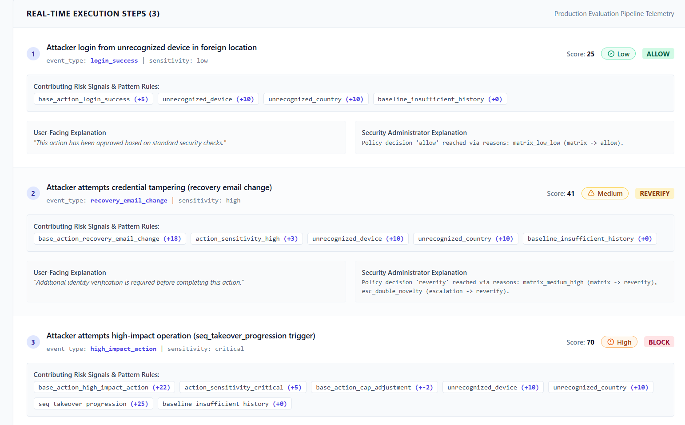

# ActionGuard

**Continuous Zero Trust security for authenticated sessions.**

ActionGuard is an open-source, self-hosted security platform designed to detect and respond to suspicious activity **after a user has logged in**. Instead of relying exclusively on login-time authentication, ActionGuard evaluates sensitive actions within an authenticated session, calculates explainable risk scores, and applies proportionate security responses.

ActionGuard aims to help applications identify potentially compromised accounts and sessions before suspicious activity results in harmful actions.

**Project:** INSA Summer Camp 2026 -- Group 2
**Location:** Jimma, Ethiopia

## 1. Project Objectives

- Continuously evaluate risk after authentication rather than relying only on login-time checks.
- Detect suspicious sequences of sensitive actions and potential account or session takeover.
- Provide explainable security decisions using named risk signals and transparent scoring.
- Apply proportionate responses based on risk, including additional verification and session containment.
- Support self-hosted deployment and extensible application integration.
- Evaluate implemented security behavior through automated tests and reproducible scenarios.

## 2. Major Features

### Risk Detection and Analysis

- **Device recognition:** Use available device signals to identify unfamiliar devices.
- **Location analysis:** Use IP and geographic information, including MaxMind GeoLite2 when configured.
- **Impossible-travel detection:** Identify suspicious geographic changes between activities.
- **Behavioral analysis:** Use timing heuristics and per-user behavioral baselines to identify unusual activity.
- **Action correlation:** Group related events into time-windowed sequences for risk analysis.

### Explainable Risk and Policy Engine

- Calculate a deterministic risk score on a 0 to 100 scale using configured signals and weights.
- Provide human-readable explanations for security decisions.
- Apply policy rules to determine an appropriate response.
- Support policy versioning and policy evaluation workflows where configured.

### Session Protection and Enforcement

Depending on the configured policy and implemented integration, responses may include:

- Allowing an action.
- Monitoring suspicious activity.
- Requesting step-up verification.
- Delaying sensitive actions using a cancellable cooling-off period.
- Blocking actions and containing suspicious sessions.

Additional session-protection capabilities include session expiration, revocation, and restricted access to sensitive operations.

### Application Integration and Monitoring

- Event-ingestion API for applications and services.
- Signed outbound webhooks where configured.
- Real-time event updates through Socket.IO.
- User-facing and administrator-facing security views.
- Rate limiting, request validation, security headers, and audit logging.

**Note:** The availability of each capability depends on the current implementation and configuration. Refer to the source code, API contract, and tests for verification.

## 3. How It Works

At a high level, ActionGuard follows a continuous evaluation process:

1. **Collect signals:** Receive relevant session, device, location, behavioral, and application-event information.
2. **Correlate activity:** Examine related actions and their timing within a session.
3. **Evaluate risk:** Calculate a score using configured signals and rules.
4. **Explain the decision:** Identify the signals and policy conditions that influenced the result.
5. **Apply a response:** Allow, monitor, require additional verification, delay, or block an action as configured.
6. **Record and monitor:** Record relevant security events and make appropriate information available for monitoring and review.

The intended principle is simple: **trust should be continuously evaluated, not permanently granted at login.**

## 4. Technology Stack

| Component                   | Technologies                                         |
| --------------------------- | ---------------------------------------------------- |
| Backend                     | Node.js, Express                                     |
| Database                    | MySQL, Sequelize                                     |
| Session and event storage   | Redis, ioredis                                       |
| Frontend                    | React, Vite, Tailwind CSS                            |
| Real-time communication     | Socket.IO                                            |
| Security and authentication | JWT, bcrypt, Helmet                                  |
| Geographic analysis         | MaxMind GeoLite2                                     |
| Testing                     | Jest, Supertest, Vitest, Testing Library, Playwright |
| Deployment                  | Docker Compose                                       |
| Version control             | Git and GitHub                                       |

The risk and policy engines use rule-based logic rather than requiring a machine-learning model. This design supports transparent scoring and traceable decisions.

Verify the listed libraries against the current project dependencies before publishing.

## 5. Requirements

Depending on the deployment method, you may need:

- Node.js 20 or newer.
- npm.
- MySQL 8.
- Redis 7.
- Docker and Docker Compose, if using containers.
- A MaxMind GeoLite2 City database file if geographic signals are enabled.

Use the versions and services supported by the current project configuration.

## 6. Installation and Setup

### Clone the repository

```bash
git clone https://github.com/AbdulhamidN/Action-guard.git
cd Action-guard
```

### Install dependencies

```bash
npm ci
cd frontend
npm ci
cd ..
```

### Configure environment variables

If the repository includes an `.env.example` file, copy it to `.env` and configure the required values.

On Windows PowerShell:

```powershell
Copy-Item .env.example .env
```

On Linux or macOS:

```bash
cp .env.example .env
```

Edit `.env` locally. Generate unique secrets for the application rather than reusing example values.

### Start the supporting services

To start only the MySQL and Redis services defined in Docker Compose:

```bash
docker compose up -d mysql redis
```

To start all services defined in Compose, including the application:

```bash
docker compose up -d --build
```

The Compose configuration requires the relevant environment variables to be set. Consult the configuration section below before starting the services.

**Database setup:** Run the project's actual database initialization or migration procedure before using the application if the database has not already been initialized. Follow the migration instructions provided by the repository; do not assume an unverified migration command.

## 7. Configuration

ActionGuard uses environment variables to configure its application and supporting services. The following table describes the principal variables; the actual required values depend on the current implementation.

| Variable                           | Purpose                                                              |
| ---------------------------------- | -------------------------------------------------------------------- |
| `PORT`                             | Application listening port                                           |
| `NODE_ENV`                         | Runtime environment                                                  |
| `DB_HOST`                          | MySQL hostname                                                       |
| `DB_USER`                          | MySQL application username                                           |
| `DB_PASSWORD`                      | MySQL application password                                           |
| `DB_NAME`                          | Database name                                                        |
| `DB_ROOT_PASSWORD`                 | MySQL root password for Docker initialization                        |
| `REDIS_URL`                        | Redis connection URL                                                 |
| `JWT_SECRET`                       | Secret used for JWT signing                                          |
| `ACTIONGUARD_ADMIN_API_KEY`        | Administrator authentication key                                     |
| `API_KEY`                          | Service authentication for supported event API endpoints             |
| `WEBHOOK_SECRET_ENCRYPTION_KEY`    | Key used to encrypt webhook secrets                                  |
| `MAXMIND_DB_PATH`                  | Path to the optional GeoLite2 City database                          |
| `SERVE_FRONTEND`                   | Controls serving the built frontend from the backend, if supported   |
| `CORS_ALLOWED_ORIGINS`             | Allowed frontend origins, according to the application configuration |
| `STEP_UP_VERIFICATION_PRIVATE_KEY` | Private key for step-up verification where required                  |
| `STEP_UP_VERIFICATION_PUBLIC_KEY`  | Public key for step-up verification where required                   |
| `ACTIONGUARD_DEMO_MODE`            | Controls supported demonstration behavior                            |

Check the application's configuration code and example environment file for the complete list of supported variables, their defaults, and which are mandatory.

### Security requirements

- Never commit `.env` or files containing real credentials.
- Use unique, randomly generated secrets.
- Keep private keys private.
- Use appropriate production configuration and HTTPS when deploying outside a trusted local environment.
- Restrict database and Redis access to trusted services.
- Replace exposed credentials immediately.
- Review security logs and access policies before exposing the application to untrusted networks.

## 8. Running the Application

Use the commands defined by the current `package.json` scripts.

### Backend

```bash
npm start
```

For backend development, if configured:

```bash
npm run dev
```

The backend is expected to listen on port `3000` unless configured otherwise.

### Frontend development

```bash
npm run dev:frontend
```

The Vite development server is expected to use port `5173` unless configured otherwise.

### Production frontend build

```bash
npm run build:frontend
```

If the backend supports serving the built frontend:

```bash
```

Set `SERVE_FRONTEND=true` in the application's environment and start the backend using the documented production command.

### Running tests

Backend tests:

```bash
npm test
```

Frontend tests:

```bash
cd frontend
npm test
```

End-to-end tests, if configured:

```bash
cd ..
npm run test:e2e
```

These commands assume the corresponding scripts exist in the repository. Check `package.json` and the frontend's `package.json` before relying on them.

## 9. Access Levels

ActionGuard supports different categories of access according to its implemented routes and authentication configuration.

| Caller             | Intended access                                                           |
| ------------------ | ------------------------------------------------------------------------- |
| Anonymous visitor  | Public endpoints, such as supported health, registration, or login routes |
| Authenticated user | Authorized personal data and actions                                      |
| Administrator      | Authorized administrative views and monitoring                            |
| Integrated service | Supported event-ingestion or service API endpoints                        |

Actual permissions depend on the application's middleware, route protections, and configured credentials. Review the API contract and security model for endpoint-level details.

## 10. Implementation Evidence





## 11. Repository Structure

The following is a conceptual overview of the project's intended organization. Adjust it to match the actual directories and files in the repository.

```text
Action-guard/
|-- src/                  # Backend application
|   |-- config/           # Application configuration
|   |-- database/         # Database models and migrations
|   |-- events/           # Event handling
|   |-- jobs/             # Background jobs
|   |-- middleware/       # Authentication and request protection
|   |-- realtime/         # Real-time communication
|   |-- routes/           # API routes
|   |-- services/         # Business and security logic
|   |-- storage/          # Storage integrations
|   +-- utils/            # Utility functions
|-- frontend/             # Frontend application
|-- policies/             # Policy configuration, if present
|-- tests/                # Automated tests
|-- e2e/                  # End-to-end tests, if present
|-- scripts/              # Helper scripts, if present
|-- docs/                 # Project documentation
|-- docker-compose.yml    # Container orchestration
|-- package.json          # Backend dependencies and scripts
+-- README.md             # Project overview and instructions
```

## 12. Documentation

Consult the documentation available in the repository for more detail on the system's design, requirements, interfaces, and security assumptions.

Relevant documents may include:

- `docs/requirements.md` - Project requirements.
- `docs/architecture.md` - Architecture and component relationships.
- `docs/security-model.md` - Security assumptions and protections.
- `docs/api-contract.md` - API interfaces and expected behavior.
- `docs/traceability.md` - Mapping between requirements and implementation.
- `docs/policy-as-code-guide.md` - Policy configuration and evaluation.
- `docs/DEMO.md` - Demonstration scenarios.
- `docs/evaluation-report.md` - Evaluation methodology and results.

Only list documents that exist in the published repository.

## 13. Testing and Evaluation

ActionGuard should be evaluated using automated tests and reproducible scenarios covering the security behaviors it implements.

Relevant evaluation areas include:

- Risk-score calculation and explanation.
- Policy decisions for different activity patterns.
- Authentication and session protection.
- Step-up verification and enforcement.
- API validation and access control.
- Event logging and session revocation.
- Frontend behavior and end-to-end flows.

Run the available tests and report the actual results before submission. Scripted scenarios help validate expected behavior but do not establish effectiveness against every real-world attacker.

## 14. Limitations

ActionGuard is a security project and should not be treated as a guarantee of protection.

- Detection quality depends on available signals, configured thresholds, and policy rules.
- An attacker using a victim's legitimate device and behaving normally may evade some behavioral checks.
- Scripted evaluations do not fully represent real-world attack patterns.
- Production deployment requires careful configuration, monitoring, testing, and security review.
- Shared administrator credentials, where used, provide less accountability than individual administrator identities.
- Email delivery and external integrations require their own configuration when not enabled by default.
- The project has not been independently security-audited unless a separate audit report is explicitly provided.

## 15. License

This project is licensed under the MIT License. Please check the repository's [LICENSE](LICENSE) file for the full applicable license terms.

MaxMind GeoLite2 data is not included in this repository and is subject to MaxMind's applicable terms.

## 16. Team

**INSA Summer Camp 2026 - Group 2**

- Abdulhamid Nuri Abasimal
- Adnan Muslim Juma
- Hayidar Taju Jemal

---
